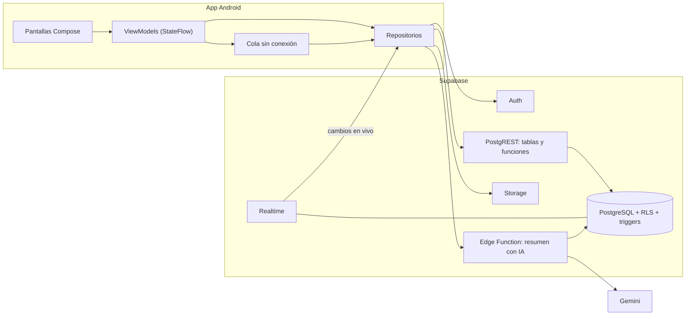

# SportPro

App Android para academias de fútbol de menores. Reúne en un solo lugar la gestión de la academia, el registro del partido en vivo y la comunicación con las familias, cuidando especialmente los datos de los menores.

Proyecto universitario. Todo lo que aparece en la app funciona con datos reales en el servidor; las mensualidades son simuladas (se registran pagos hechos fuera de la app, no se mueve dinero).

## Qué hace

- **Academia:** el superadmin invita administradores; el administrador crea equipos e invita entrenadores (DT) con un código QR.
- **Familias y menores:** el apoderado crea el perfil de sus hijos menores de 13 años. Un jugador de 13 a 17 no puede usar la app hasta que su apoderado apruebe el vínculo.
- **Equipos:** el DT invita jugadores con el QR del equipo, acepta solicitudes, asigna dorsal y posición, y da de baja con motivo.
- **Partidos:** crear partido (rival registrado o externo), convocatoria, formación y alineación automática.
- **Partido en vivo:** registro de un evento en 3 toques, reloj compartido entre celulares, tiempo real y funcionamiento sin conexión sin duplicar eventos.
- **Correcciones:** corregir o anular un evento con motivo; nada se borra.
- **Resumen con IA:** al terminar, la IA redacta un borrador solo con los eventos registrados. El DT lo revisa, lo edita y lo publica.
- **Feed:** publicaciones con me gusta y comentarios moderados.
- **Mensualidades (simuladas):** el DT elige quién paga, la familia informa el pago y el administrador lo confirma.
- **Documentos:** DNI, ficha médica, seguro y autorización de viaje en un almacenamiento privado, con aprobación del DT o el administrador.
- **Avisos de pruebas:** las academias publican pruebas, las familias buscan con filtros e inscriben a sus hijos.
- **Notificaciones:** en tiempo real, con ajustes por categoría; al tocarlas abren su pantalla.

## Capturas

> Reemplaza cada línea por la imagen correspondiente (por ejemplo ``).

| Inicio y feed | Partido en vivo | Registro en 3 toques |
|---|---|---|
| _captura pendiente_ | _captura pendiente_ | _captura pendiente_ |

| Alineación | Resumen con IA | Mensualidades |
|---|---|---|
| _captura pendiente_ | _captura pendiente_ | _captura pendiente_ |

| Documentos | Avisos de pruebas | Notificaciones |
|---|---|---|
| _captura pendiente_ | _captura pendiente_ | _captura pendiente_ |

## Stack

| Parte | Tecnología |
|---|---|
| App | Kotlin 2.4.0, Jetpack Compose (BOM 2026.02.01, Material 3), Navigation Compose 2.10.2 con rutas tipadas |
| Compilación | Android Gradle Plugin 9.4.1, Gradle 9.6.0, `minSdk` 29 |
| Cliente de datos | supabase-kt 3.8.0 (Auth, PostgREST, Realtime, Storage, Functions) sobre Ktor OkHttp 3.5.1 |
| QR | ZXing 3.5.4 para generar y el escáner de Google Play services para leer |
| Servidor | Supabase: PostgreSQL con Row Level Security, funciones `SECURITY DEFINER`, triggers, Realtime y Storage |
| IA | Edge Function en Deno que llama a Gemini; la clave vive solo en el servidor |
| Pruebas | JUnit 4 para la lógica pura; SQL en un Postgres desechable con Docker |

## Arquitectura

La app sigue el patrón MVVM: cada pantalla observa el estado de su ViewModel, y el ViewModel pide los datos a un repositorio. Los repositorios son la única capa que habla con Supabase.



Ideas principales:

- **Las reglas viven en el servidor.** Cada permiso y cada regla de negocio se valida en SQL. La app valida solo para mostrar un mensaje claro antes de enviar.
- **Lo calculado no se guarda.** El marcador, las estadísticas, el minuto del partido, los jugadores en cancha y el estado «vencido» de un cobro se calculan a partir de los datos base, así nunca se contradicen.
- **Nada se borra.** Los eventos se anulan, los pagos se anulan, los jugadores se dan de baja y los documentos se reemplazan; siempre con motivo y registro en la bitácora de auditoría.

Carpetas del código (`app/src/main/java/com/sportpro/app/`):

| Carpeta | Contenido |
|---|---|
| `core/` | Contenedor de dependencias, acceso a textos y enlaces de invitación y de equipo |
| `core/data/` | Modelos y lógica pura (posiciones, reloj, mensualidades, documentos, pruebas) |
| `core/data/repo/` | Repositorios: la única capa que llama a Supabase |
| `core/data/offline/` | Cola de eventos sin conexión |
| `ui/<pantalla>/` | Pantallas Compose y sus ViewModels |
| `ui/components/` | Componentes compartidos |

## Instalación

### 1. Requisitos

- Android Studio reciente y un celular o emulador con Android 10 o superior.
- Un proyecto de Supabase.
- Docker Desktop, solo si quieres correr las pruebas de SQL en tu PC.

### 2. Clonar y configurar la app

```bash
git clone https://github.com/AldoRJ24/SportPro.git
```

Crea el archivo `local.properties` en la raíz del proyecto con estas dos líneas:

```properties
SUPABASE_URL=https://<id-del-proyecto>.supabase.co
SUPABASE_PUBLISHABLE_KEY=<clave publicable>
```

Ambos valores están en Supabase → **Project Settings → API**. Usa siempre la clave **publicable**. La clave secreta y la contraseña de la base de datos no van en este archivo ni en ningún otro del proyecto. `local.properties` está en `.gitignore` y no se sube.

### 3. Base de datos

En Supabase → **SQL Editor**, ejecuta las migraciones de `supabase/migrations/` **una por una y en este orden**. Cada archivo es transaccional: si algo falla, no se aplica nada.

| # | Archivo | Contenido |
|---|---|---|
| 001 | `20261107000000_sportpro_core.sql` | Núcleo: academias, equipos, jugadores, partidos, eventos, resumen con IA, auditoría y RLS |
| 002 | `20261107120000_positions_formations.sql` | Posiciones, formaciones y la regla de un arquero titular |
| 003 | `20261107150000_accounts_invites_guardians.sql` | Tipos de cuenta, invitaciones, vínculo apoderado–menor y notificaciones |
| 004 | `20261107170000_avatars.sql` | Foto de perfil |
| 005 | `20261107180000_academy_logo.sql` | Foto de la academia, heredada por sus equipos |
| 006 | `20261107190000_feed_posts.sql` | Feed: me gusta y comentarios moderados |
| 007 | `20261107200000_team_join.sql` | Unirse a un equipo con código |
| 008 | `20261115100000_fees.sql` | Mensualidades simuladas |
| 009 | `20261115110000_documents.sql` | Documentos del jugador en un bucket privado |
| 010 | `20261116100000_notification_prefs.sql` | Ajustes de notificaciones y avisos de convocatoria y partido en vivo |
| 011 | `20261116110000_tryouts.sql` | Avisos de pruebas e inscripciones |
| 012 | `20261116120000_roster_admin.sql` | Dorsal y baja de jugadores con motivo |
| 013 | `20261116130000_security_hardening.sql` | Cierre de huecos de la revisión final de seguridad |
| 014 | `20261117100000_match_favorites.sql` | Partidos favoritos y lista «mis partidos» |
| 015 | `20261117110000_match_challenges.sql` | Desafíos entre equipos de distintas academias |

Las migraciones 002 a 015 se pueden volver a ejecutar sin romper nada.

### 4. Autenticación

1. **Authentication → URL Configuration → Redirect URLs:** agrega `sportpro://auth-callback`.
2. **Authentication → Email Templates → Confirm signup:** pega el contenido de `supabase/email/confirm_signup.html`.

### 5. Edge Function del resumen con IA

1. **Edge Functions → Deploy a new function → Via Editor.** Nombre: `generate-match-summary`. Pega `supabase/functions/generate-match-summary/index.ts`.
2. Desactiva **Verify JWT**: la función valida al usuario por su cuenta.
3. En **Edge Functions → Secrets** crea estos secretos:

| Secreto | Para qué |
|---|---|
| `GEMINI_API_KEY` | Clave de Google AI Studio |
| `GEMINI_MODEL` | Opcional. Modelo a usar; por defecto `gemini-3.6-flash` |

Los valores se escriben solo en esa pantalla de Supabase. No van en el código ni en el repositorio.

### 6. Primer superadmin y datos de demo

1. Regístrate desde la app con tu cuenta principal.
2. En el **SQL Editor**, conviértela en superadmin:

```sql
insert into public.platform_admins (user_id)
select id from auth.users where email = 'tu-correo@ejemplo.com';
```

3. Opcional: `supabase/seed_demo.sql` crea una academia de demostración con datos ficticios. Edita los dos correos del inicio del archivo antes de ejecutarlo.

### 7. Ejecutar

En Android Studio: **Sync Project with Gradle Files** y luego **Run**. Si la app muestra «Falta configuración», revisa `local.properties` y vuelve a sincronizar.

## Roles

| Rol | Cómo se obtiene | Qué puede hacer |
|---|---|---|
| Superadmin | Se inserta a mano en la base de datos | Invitar administradores. Es el único que puede cambiar el estado de una academia (verificada o suspendida); hoy se hace desde el SQL Editor, no hay pantalla |
| Administrador | Invitación del superadmin (`ADM-…`) | Crear equipos, invitar y asignar DT, fijar mensualidades y confirmar pagos, foto de la academia |
| DT | Invitación del administrador (`DT-…`) | Plantel, partidos, registro en vivo, correcciones, resumen con IA, revisar documentos, publicar pruebas |
| Operador | Lo designa el DT para un partido | Registrar eventos de ese partido mientras está en juego |
| Apoderado | Registro libre (18 años o más) | Crear y vincular a sus hijos, responder convocatorias, pagar, subir documentos, inscribir a pruebas |
| Jugador | Registro libre (13 años o más) | Ver sus partidos y estadísticas; si es menor, solo tras la aprobación de su apoderado |

Nadie puede darse a sí mismo un rol: el tipo de cuenta lo fija el servidor al registrarse y los roles de administrador y DT exigen una invitación válida.

## Seguridad y privacidad

- **Claves:** en el APK y en el repositorio solo va la clave publicable, leída de `local.properties` mediante `BuildConfig`. La clave secreta, `service_role`, la contraseña de Postgres y la clave de Gemini nunca salen del servidor.
- **Row Level Security** en las 37 tablas. El rol anónimo no tiene permisos sobre ninguna tabla.
- **Escritura por funciones:** las tablas sensibles (pagos, documentos, notificaciones, inscripciones, auditoría) no aceptan escrituras directas; solo funciones del servidor que validan permisos.
- **Menores:** aparecen como «Nombre I.» para quien no es su apoderado ni su staff, no tienen foto, sus datos sensibles están en una tabla aparte y la IA solo recibe seudónimos (`J1`, `R1`…).
- **Documentos:** bucket privado; cada archivo se abre con una URL firmada que vence en 5 minutos.
- **Trazabilidad:** toda acción importante queda en `audit_log`.

El detalle de la revisión final está en [docs/seguridad.md](docs/seguridad.md).

## Pruebas

Tests unitarios de la lógica pura (114 tests, sin red ni emulador):

```bash
./gradlew.bat testDebugUnitTest
```

Pruebas de SQL (auditoría de seguridad de 11 reglas y prueba de humo de 377 checks). Con Docker Desktop abierto y desde Git Bash:

```bash
bash supabase/test/run_local.sh
```

El script levanta un Postgres desechable, aplica las 15 migraciones dos veces para comprobar que son repetibles, audita los permisos y recorre los flujos completos con usuarios de prueba ficticios. No toca el proyecto real de Supabase.

## Documentación

| Documento | Contenido |
|---|---|
| [docs/modelo-de-datos.md](docs/modelo-de-datos.md) | Las 37 tablas y qué guarda cada una |
| [docs/partido-en-vivo.md](docs/partido-en-vivo.md) | Flujo del partido: reloj, registro, tiempo real y modo sin conexión |
| [docs/decisiones-tecnicas.md](docs/decisiones-tecnicas.md) | Decisiones de diseño y sus motivos |
| [docs/seguridad.md](docs/seguridad.md) | Revisión final de seguridad y sus hallazgos |
| [docs/manual-de-usuario.md](docs/manual-de-usuario.md) | Manual de uso por rol y guion de demostración |

`DISEÑO_TECNICO_W7.md` es el diseño preliminar de la semana 7 y se conserva como antecedente; la implementación final es la descrita en `docs/`.

## Limitaciones conocidas

- **Notificaciones push:** llegan en tiempo real solo con la app abierta. No hay envío con la app cerrada.
- **Mensualidades:** son un registro de pagos hechos por fuera; no hay pasarela de pago.
- **Idioma:** la interfaz está solo en español.
