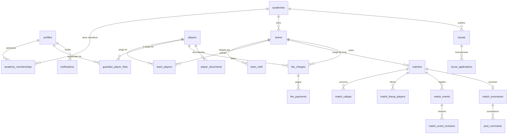

# Modelo de datos

La base de datos es PostgreSQL en Supabase. Tiene **37 tablas** en el esquema `public`, todas con Row Level Security activado. Se crean con las 15 migraciones de `supabase/migrations/`.

Reglas que valen para todas las tablas:

- **Lectura:** cada tabla tiene una política que decide qué filas ve cada usuario.
- **Escritura:** solo algunas tablas aceptan escrituras directas desde la app, y siempre limitadas por política y por columnas. El resto se escribe únicamente con funciones del servidor.
- **Rol anónimo:** una persona sin sesión no tiene permisos sobre ninguna tabla.

## Vista general

El diagrama muestra solo las relaciones principales. Las tablas completas están abajo, agrupadas por tema.

## 1. Personas y cuentas

| Tabla | Qué guarda | Notas |
|---|---|---|
| `profiles` | Un perfil por cuenta: nombre, fecha de nacimiento, foto, tipo de cuenta y código familiar del apoderado | Se crea sola al registrarse. El tipo de cuenta lo fija el servidor y no se puede cambiar desde la app |
| `platform_admins` | Quiénes son superadmin | No tiene ninguna política: solo se llena a mano desde el SQL Editor |
| `invitations` | Códigos de invitación para administrador (`ADM-…`) y DT (`DT-…`): quién la creó, vencimiento y quién la usó | De un solo uso y vencen a los 7 días |
| `guardian_player_links` | Vínculo entre un apoderado y un jugador, con su estado (pendiente, aprobado, rechazado, revocado) | Es la base de casi todos los permisos sobre menores |
| `notifications` | Avisos de cada usuario: tipo, título, texto, datos para navegar y si ya se leyó | La app solo puede marcar como leído |
| `notification_prefs` | Qué categorías de avisos apagó cada usuario | Si no hay fila, la categoría está encendida |

## 2. Academias y equipos

| Tabla | Qué guarda | Notas |
|---|---|---|
| `academies` | Academia: nombre, ciudad, foto y estado (pendiente, verificada, suspendida) | Solo el superadmin cambia el estado |
| `academy_memberships` | Qué rol tiene cada usuario en cada academia (administrador, DT, jugador, apoderado) | Un administrador no puede crear otro administrador |
| `teams` | Equipo: nombre, categoría, edad máxima, formato por defecto, minutos por tiempo y código para unirse | La foto se copia siempre de su academia |
| `team_staff` | Qué DT o asistente dirige cada equipo | Lo asigna el administrador |
| `players` | Perfil deportivo del jugador: nombre, fecha de nacimiento y posición | Puede existir sin cuenta (menores de 13, creados por su apoderado) |
| `player_private_data` | Datos sensibles del jugador: talla, peso, teléfono y contacto de emergencia | Separados a propósito: solo los ven el apoderado, el propio jugador y su staff |
| `team_players` | Plantel: jugador, equipo, dorsal, posición habitual y estado | La baja no borra: pasa a inactivo con motivo y fecha |
| `team_join_requests` | Solicitudes para entrar a un equipo con su código | Siempre decide el DT |
| `follows` | Qué academias o equipos sigue cada usuario | Los seguidores ven los partidos en vivo |

## 3. Partidos

| Tabla | Qué guarda | Notas |
|---|---|---|
| `matches` | Partido: equipos, formato, fecha, sede, visibilidad, estado, periodo, datos del reloj y marcador | El estado, el reloj y el marcador solo los cambian funciones y triggers del servidor |
| `match_external_players` | Plantel escrito a mano de un rival que no usa la app | Permite registrar eventos del rival con nombre y dorsal |
| `match_operators` | Quién registra los eventos de un partido | Como máximo un operador activo por partido |
| `match_callups` | Convocatoria: jugador, estado (pendiente, confirmado, no asiste) y quién respondió | Solo se puede alinear a quien confirmó |
| `match_lineup_players` | Alineación: titular o suplente y posición en cancha, para ambos lados | El servidor exige exactamente un arquero titular para iniciar |
| `event_types` | Catálogo de tipos de evento (gol, penal, tarjetas, cambio, falta, atajada…), con su icono y qué datos exige | Cada academia puede tener tipos propios |
| `match_events` | Cada evento del partido: tipo, periodo, minuto, añadido, lado, jugador y datos extra | No se borra ni se edita directo. Lleva `client_event_id` para que un reenvío no lo duplique |
| `match_event_revisions` | Versión anterior de un evento cada vez que se corrige o anula, con quién y por qué | La escribe un trigger |
| `match_challenges` | Desafío de un equipo a otro: ajustes propuestos (jugadores, minutos, fecha, sede), estado (pendiente, aceptado, rechazado, cancelado) y el partido creado al aceptar | Solo lo ven quienes gestionan los dos equipos. «Vencido» se calcula |
| `match_favorites` | Partidos que cada usuario marcó con la estrella | Preferencia personal: solo la ve su dueño y se cambia con `toggle_match_favorite` |

## 4. Resumen con IA y feed

| Tabla | Qué guarda | Notas |
|---|---|---|
| `match_summaries` | Resumen del partido: texto de la IA, texto final, estado (borrador o aprobado), visibilidad y si acepta comentarios | Nada se publica sin la aprobación del DT |
| `match_summary_versions` | Cada versión generada o editada del resumen | Máximo 3 generaciones por partido |
| `post_likes` | Me gusta de cada usuario en una publicación | Uno por usuario y publicación |
| `post_comments` | Comentarios de una publicación | Al moderar se vacía el texto, pero la fila queda y el original va a auditoría |

## 5. Mensualidades (simuladas)

| Tabla | Qué guarda | Notas |
|---|---|---|
| `fee_plans` | Plan del equipo: monto y día de vencimiento | Lo define el administrador |
| `fee_players` | Qué jugadores del equipo pagan mensualidad | Los elige el DT |
| `fee_charges` | Cobro mensual por jugador: mes, monto, vencimiento y estado (pendiente, pagado, exonerado) | Único por equipo, jugador y mes. «Vencido» se calcula |
| `fee_payments` | Movimientos de pago: método, número de operación, quién lo informó, quién lo decidió y el motivo | Un cobro solo puede tener un pago vivo a la vez |

## 6. Documentos

| Tabla | Qué guarda | Notas |
|---|---|---|
| `player_documents` | Documento del jugador: tipo, ruta del archivo, vencimiento, estado y revisión | Subir una versión nueva deja la anterior como reemplazada |

Los archivos están en el bucket privado `documents` de Storage, en la carpeta `<id del jugador>/`. No tienen política de modificación ni de borrado.

## 7. Avisos de pruebas

| Tabla | Qué guarda | Notas |
|---|---|---|
| `tryouts` | Aviso de prueba: academia, categoría, rango de edad, posiciones, fecha, lugar, distrito, cupos y estado | Solo academias verificadas |
| `tryout_applications` | Inscripción de un jugador a una prueba, con su estado y motivo | Una inscripción viva por jugador y aviso |

## 8. Auditoría

| Tabla | Qué guarda | Notas |
|---|---|---|
| `audit_log` | Bitácora: quién hizo qué, sobre qué y cuándo, con los datos relevantes | Solo la escriben funciones del servidor; nadie la edita |

## Buckets de Storage

| Bucket | Público | Contenido | Quién escribe |
|---|---|---|---|
| `avatars` | Sí | Fotos de perfil | Cada adulto, solo en su carpeta. Los menores no pueden publicar foto |
| `academy-logos` | Sí | Foto de la academia | El administrador, solo en la carpeta de su academia |
| `documents` | **No** | Documentos de jugadores | El apoderado (o el jugador adulto), solo en la carpeta del jugador |

## Funciones del servidor

La app llama a funciones SQL (RPC) para todo lo que cambia datos sensibles. Las más importantes, por tema:

| Tema | Funciones |
|---|---|
| Partido | `change_match_state`, `set_match_operator`, `correct_match_event`, `void_match_event`, `get_match_timeline`, `get_match_lineup` |
| Desafíos | `challenge_rival_teams`, `challenge_create`, `challenge_respond`, `challenge_cancel`, `my_challenges` |
| Lista de partidos | `my_matches` (qué partidos le corresponden al usuario y por qué), `toggle_match_favorite` |
| Estadísticas | `get_player_stats`, `get_team_stats` |
| Resumen con IA | `build_ai_payload`, `upsert_ai_summary`, `save_summary_edit`, `approve_summary` |
| Cuentas y familia | `my_account`, `redeem_invitation`, `request_guardian_link`, `respond_guardian_link`, `create_child_player` |
| Equipos | `team_join_code`, `request_team_join`, `respond_team_join`, `team_set_jersey`, `team_remove_player` |
| Feed | `get_feed`, `toggle_post_like`, `add_post_comment`, `delete_post_comment` |
| Mensualidades | `fee_set_plan`, `fee_set_player`, `fee_generate_charges`, `fee_report_payment`, `fee_decide_payment`, `fee_statement` |
| Documentos | `doc_register`, `doc_review`, `doc_list`, `doc_team_status` |
| Pruebas | `tryout_create`, `tryout_search`, `tryout_apply`, `tryout_decide` |
| Notificaciones | `my_notification_prefs`, `set_notification_pref`, `mark_all_notifications_read` |

Todas las funciones que se ejecutan con permisos elevados (`SECURITY DEFINER`) fijan su `search_path` y comprueban dentro quién las llama.
