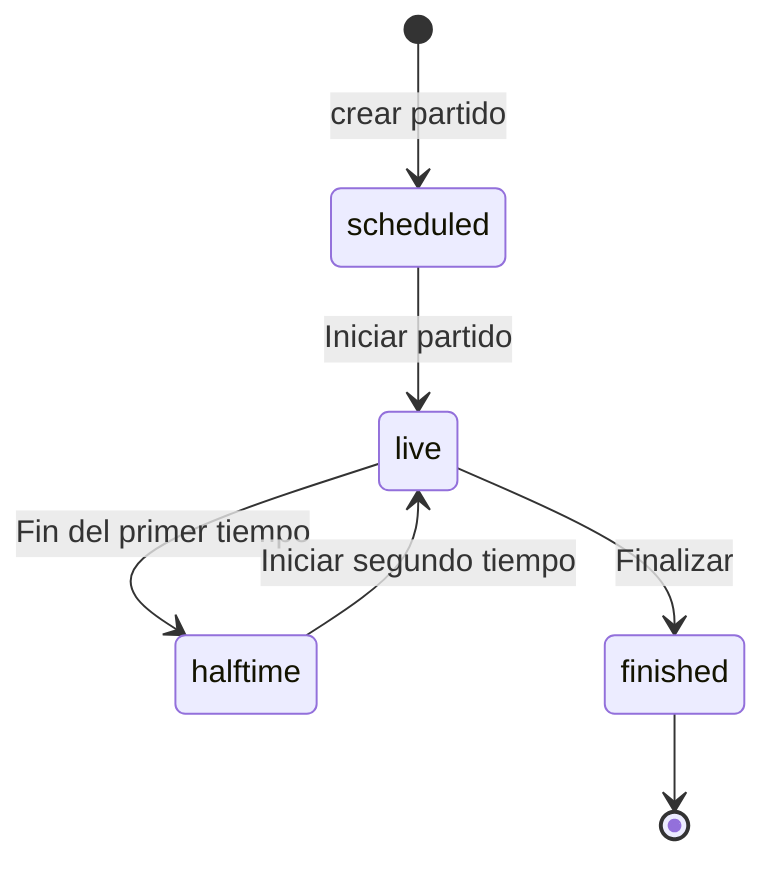
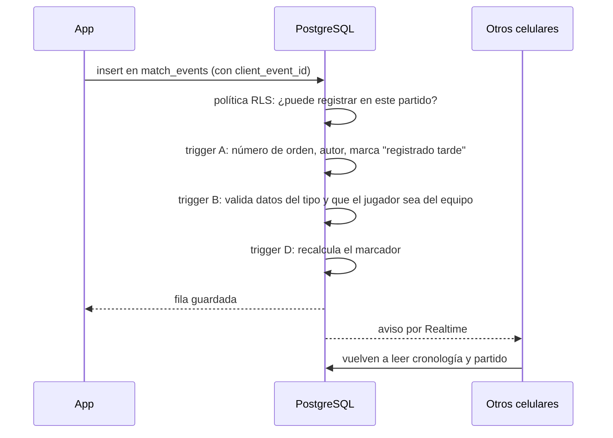
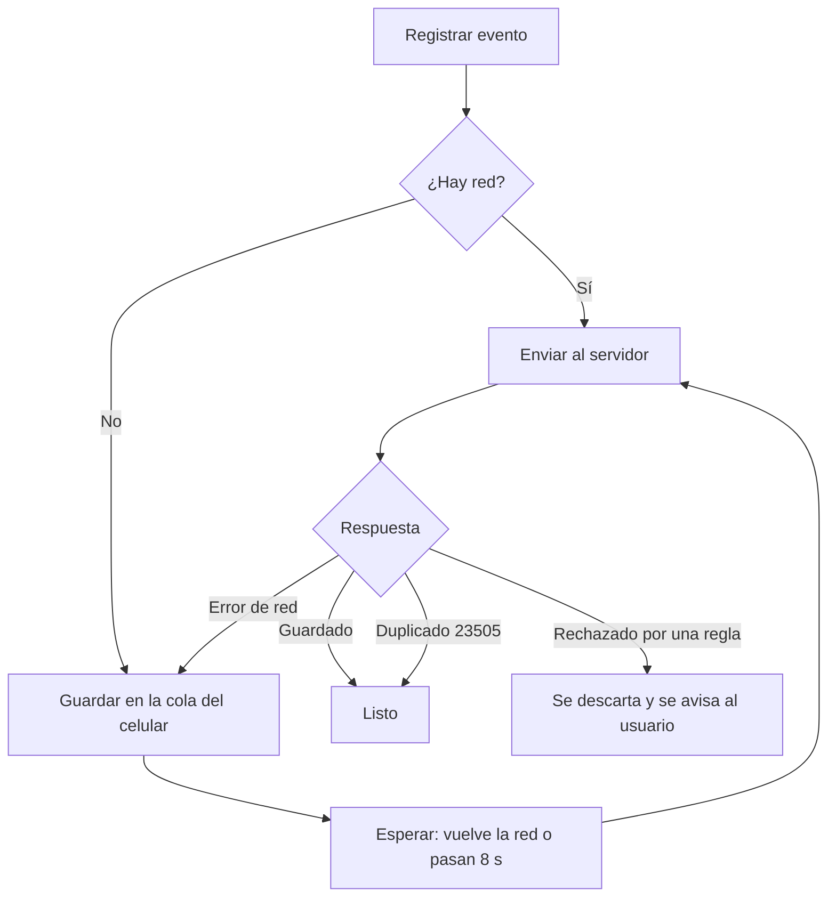
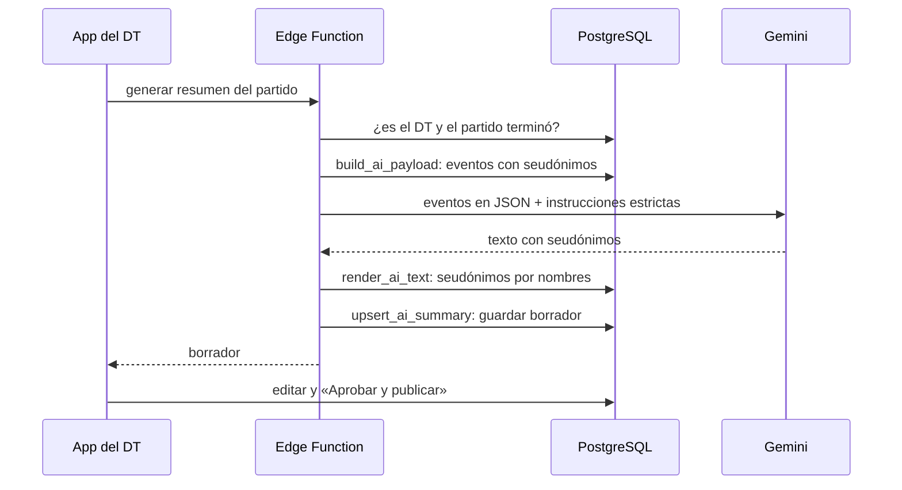

# Flujo del partido en vivo

Este documento explica cómo funciona el registro de un partido: desde que se crea hasta que se publica el resumen. Es la parte más delicada de SportPro porque se usa en la cancha, con varios celulares a la vez y con mala señal.

## 1. Estados del partido

El estado solo cambia con la función `change_match_state(partido, acción)`. Las acciones son `start`, `halftime`, `second_half` y `finish`. La base de datos también contempla el estado `cancelled`, pero hoy no existe una acción para cancelar un partido desde la app. La app no puede escribir el estado, el periodo ni el marcador directamente: no tiene permiso sobre esas columnas.

Antes de dejar iniciar, el servidor comprueba que:

- los dos lados tengan tantos titulares como el formato del partido;
- cada lado tenga exactamente un arquero titular;
- quien lo pide sea el DT, el administrador o el operador del partido.

Cada cambio de estado crea además un evento de control (inicio, fin del primer tiempo…), que aparece en la cronología.

## 2. Preparación

1. **Crear el partido.** El rival puede ser un equipo registrado o uno externo. Para el externo, el DT escribe su plantel con dorsal, nombre y posición; se guarda en `match_external_players`.
2. **Convocatoria.** El DT convoca jugadores (`match_callups`). Un trigger avisa a cada apoderado y al jugador. Solo quien confirma puede ser alineado.
3. **Alineación.** El DT elige la formación (siempre un arquero). «Armar automático» propone titulares entre los confirmados según su posición habitual.
4. **Operador.** El DT designa a la persona que registrará los eventos. Solo puede haber un operador activo por partido.

## 3. El reloj

No hay un cronómetro corriendo en cada celular. El minuto se **calcula** con tres datos que guarda el servidor en `matches`:

| Dato | Significado |
|---|---|
| `period_started_at` | Hora del servidor en que empezó el periodo actual |
| `elapsed_before_seconds` | Segundos jugados antes de la última pausa |
| `clock_running` | Si el reloj está corriendo |

Segundos jugados = `elapsed_before_seconds` + (ahora − `period_started_at`), si el reloj corre.

Con eso, todos los celulares muestran el mismo minuto aunque abran la app tarde o pierdan la señal un rato. Las reglas de presentación son:

- el primer minuto es el 1';
- el segundo tiempo empieza en el minuto siguiente al final del primero (con tiempos de 25, empieza en el 26');
- pasado el tiempo reglamentario se muestra el añadido, por ejemplo 25+3'.

La lógica está en `MatchRow.clock()` (`core/data/Time.kt`) y tiene tests en `TimeTest`.

## 4. Registrar un evento en 3 toques

1. **Tipo de evento.** Gol, penal, tarjeta, cambio, falta, atajada… El minuto se toma del reloj y se puede ajustar.
2. **Equipo.**
3. **Jugador.** Se ofrecen los que están en cancha, o «Sin identificar».

Casos especiales que la app resuelve sola:

- **Atajada y penal atajado:** se asignan al arquero que está en cancha en ese momento.
- **Cambio:** se elige quién sale y quién entra; el que entra hereda la posición.
- **Autogol:** el gol suma al equipo contrario.
- **Roja:** el jugador sale de la cancha y deja de ofrecerse.

### Jugadores en cancha

Quién está en cancha tampoco se guarda: se calcula con la función `onFieldPlayers` (`core/data/Positions.kt`).

1. Se parte de los titulares de la alineación.
2. Se recorren los eventos vigentes en orden de juego (periodo, minuto, añadido).
3. Un cambio saca a un jugador y mete a otro; una roja saca al expulsado.

Como se ordena por minuto y no por hora de llegada, un evento que llega tarde cae en su lugar correcto.

## 5. Qué pasa en el servidor al insertar un evento

Puntos clave:

- **Quién puede registrar:** el DT o el administrador siempre; el operador solo mientras el partido está en juego. Con el partido finalizado solo el DT, y el evento queda marcado como registrado tarde.
- **Orden:** el servidor asigna un número de secuencia bajo un bloqueo por partido, para que dos registros simultáneos no choquen.
- **Marcador:** se recalcula a partir de los eventos vigentes; nunca se suma «a mano».

## 6. Tiempo real

La app se suscribe con Realtime a los cambios de `matches`, `match_events`, `event_types` y `match_callups` del partido abierto. Cuando llega un aviso, vuelve a pedir los datos al servidor; no confía en el contenido del aviso. Así, lo que se ve siempre pasó por las políticas de lectura.

## 7. Sin conexión

El problema: en la cancha la señal se cae, y un gol no se puede perder ni contar dos veces.

La solución está en `PendingEventQueue` (`core/data/offline/`):

1. Cada evento nace en el celular con un identificador único, `client_event_id`.
2. Si hay señal, se envía de inmediato.
3. Si la red falla, el evento se guarda en un archivo dentro del celular. Sobrevive aunque se cierre la app.
4. La cola se reintenta cuando Android avisa que volvió la red y, además, cada 8 segundos.
5. Los pendientes se envían en el orden en que se registraron.

Por qué nunca se duplica: la tabla tiene una restricción única sobre (partido, `client_event_id`). Si un envío llegó al servidor pero la respuesta se perdió, el reintento recibe el error «duplicado» (23505). La app lo interpreta como «ya estaba guardado» y lo quita de la cola.

Un rechazo por regla de negocio (por ejemplo, el jugador no pertenece al equipo) no se reintenta: se descarta y se muestra el motivo.

## 8. Deshacer, corregir y anular

- **Deshacer:** justo después de registrar aparece la opción durante unos segundos. Si el evento todavía está en la cola del celular, se descarta; si ya llegó, se anula.
- **Corregir** (`correct_match_event`): cambia minuto, jugador o datos, con motivo obligatorio.
- **Anular** (`void_match_event`): el evento queda en la cronología marcado como anulado y deja de contar.

En ambos casos un trigger guarda la versión anterior en `match_event_revisions`, con quién lo hizo y por qué. Nada se borra. El DT puede corregir siempre; el operador solo mientras el partido está en juego.

## 9. Estadísticas

Las funciones `get_player_stats` y `get_team_stats` cuentan los eventos vigentes de partidos finalizados. Como salen de los mismos eventos que el marcador, una corrección o una anulación se refleja sola en todo.

## 10. Resumen con IA

- **Privacidad:** la IA recibe a los jugadores como `J1`, `J2`, `R1`… Nunca recibe un nombre. El servidor reemplaza los seudónimos después.
- **Sin inventos:** las instrucciones obligan a usar solo los eventos del JSON.
- **Control humano:** se permiten hasta 3 generaciones, el DT puede editar el texto y nada se publica sin su aprobación.
- **Clave protegida:** la clave de Gemini es un secreto de la Edge Function. No está en la app.

## 11. Registro por el árbitro desde la web

El DT del equipo local pulsa «QR del árbitro» en el partido. El árbitro lo escanea y registra desde una página web, sin cuenta, con el mismo flujo de 3 toques, la misma cola sin conexión y el mismo «Deshacer». Lo que registra entra en `match_events`, así que la app lo muestra al instante por Realtime. Detalles de publicación y seguridad en `referee-web/README.md` y `docs/seguridad.md`.

## 12. Dónde está cada parte en el código

| Parte | Archivo |
|---|---|
| Pantalla del partido | `ui/match/MatchDetailScreen.kt` |
| Lógica de registro, deshacer y corrección | `ui/match/MatchDetailViewModel.kt` |
| Selector de evento, equipo y jugador | `ui/match/RecorderSheet.kt` |
| Corregir y anular | `ui/match/EditEventDialog.kt` |
| Reloj y etiquetas de estado | `core/data/Time.kt` |
| Formaciones y jugadores en cancha | `core/data/Positions.kt` |
| Cola sin conexión | `core/data/offline/PendingEventQueue.kt` |
| Llamadas al servidor y Realtime | `core/data/repo/MatchRepository.kt` |
| Reglas del servidor | `supabase/migrations/20261107000000_sportpro_core.sql` |
| Resumen con IA | `supabase/functions/generate-match-summary/index.ts` |
| QR del árbitro (app) | `ui/match/RefereeQrDialog.kt`, `core/RefereeLinks.kt` |
| Página del árbitro | `referee-web/` |
